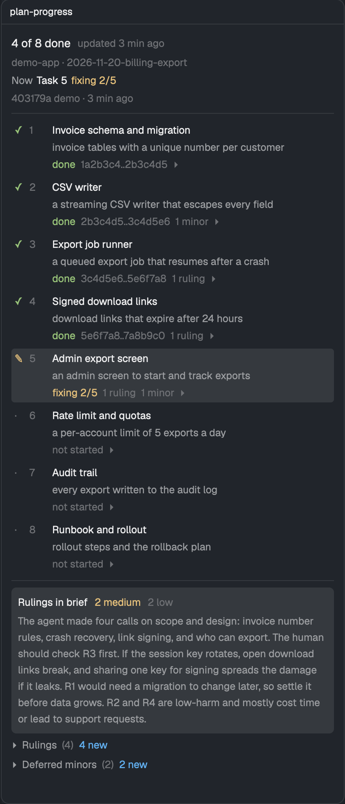

# Plan progress — a Herdr mod

A column on the right of the [Herdr](https://herdr.dev) window that shows where the focused agent's implementation plan is: every task and its status, what each task is for, and the decisions the agent made on its own ("rulings"), summarized in plain English with a risk level. It follows the agent you focus and hides itself when that agent has no plan.



It reads plans run with the **subagent-driven development** loop from [superpowers](https://github.com/obra/superpowers): a plan with `### Task N: <name>` headings and a ledger at `<worktree>/.superpowers/sdd/<plan-name>/progress.md`.

## Install

Ask your agent in Herdr: *"Add the Herdr mod github.com/shaiu/herdr-plan-progress"*. Herdr's own instructions copy `mods/plan-progress/` into your mods folder.

Or by hand:

```sh
git clone https://github.com/shaiu/herdr-plan-progress
herdr-plan-progress/install.sh
```

`install.sh` copies the mod into `~/.config/herdr-app/mods/plan-progress` (a copy: Herdr doesn't reload through a symlink) and runs `herdr-app check`. Run it again after `git pull`. The column docks on the right the first time Herdr sees it.

To watch one plan whatever is focused, open a pinned copy as a pane:

```sh
herdr-app do pane.split '{"direction":"right","mod":"plan-progress","props":{"plan":"/abs/path/to/plan.md"}}'
```

## What it runs

It only reads. It runs `git` (`rev-parse`, `log -1`, `rev-list --count`), `ls`, `stat`, `tail`, and `hc get`, and reads your Claude Code session files under `~/.claude/` to find the folder an agent is really working in.

It also runs **`claude -p` with Haiku** to summarize the rulings, which uses your Claude account. It sends only the ruling lines of the ledger, with no tools and none of your settings, hooks or plugins. Results are cached by ruling text in `~/.config/herdr-app/plan-progress-summaries.json`, so only rulings it hasn't seen before cost a call (about $0.002 for a plan's worth). The rest of the column works without it.

## Develop

```sh
npm test        # node --test: the parser, on example plans and ledgers
./install.sh    # copy into Herdr and check it
```

`RECIPE.md` describes the mod fully enough to rebuild it from scratch.

## License

MIT
