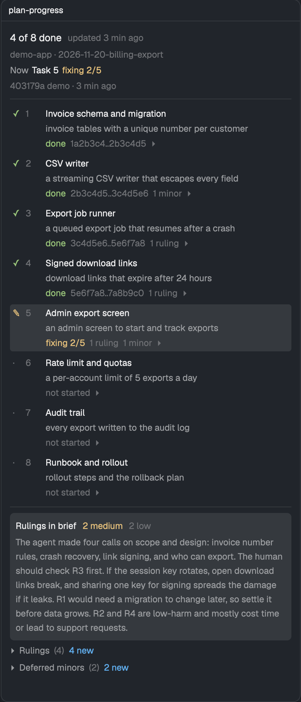

# Plan progress

A column on the right of the Herdr window that shows where the focused agent's implementation plan is. It follows the agent you focus: for an agent running a "subagent-driven development" plan (a `.superpowers/sdd/<plan>/progress.md` ledger in its git worktree) it lists every task with its status, what each task is for, and the decisions ("rulings") the agent made on its own, summarized in plain English with a risk level. When the focused agent has no active plan, the column hides itself. It only reads: files, `git log`, `hc get`.

## What you see

One column, 380px wide (`mod.json`: `"place": "right", "size": 380`), theme `surface` background, 12px padding, 12.5px UI text, scrolls vertically. Top to bottom:

1. **Header.** "8 of 12 done" (14px, semibold) and, dim, "updated 2 min ago" (the ledger's change time; "· polling" is added when the folder watch can't run). Under it, dim: `<worktree name> · <plan name>`. A line "Now Task 9 fixing 2/5 · 2 commits since 85f26b0" (the current task, its status in the status color, commits after the last completed task). Then the newest commit, dim and truncated: `645250f fix(x): … · 3 min ago`. A red line "Plan file not found: …" when the ledger names a plan that is missing.
2. **A 1px `border` line.**
3. **Task rows**, one per `### Task <id>: <name>` heading of the plan. Each row: a 12px mark in the status color, a 22px dim id, then a column: the name (semibold for the current task), a muted one-line intent, and a line with the status word in its color, the commit range (dim, for done tasks), "2 rulings", "1 minor", "1 high-risk" (in `blocked` red) and a dim "▸" when there is more to open. The current task's row has the `selected` background; every row has `hover` on hover.
   - Marks and colors: `·` not started (`dim`), `▶` implementing (`working`), `◎` in review (`ansi4`), `✎` fixing, shown as "fixing 2/5" (`ansi3`), `■` blocked (`blocked`), `✓` done (`ansi2`).
   - Opened, a row stops truncating and adds: "Files (n)", each file name with its folder dim after it; "Rulings (n)", the ruling rows below; "Ledger (n)", every ledger line for that task, oldest first.
4. **Another 1px line.**
5. **"Rulings in brief"**, a box (`raised` background, radius 6, 8px padding): the title (semibold), counts "2 high" (`blocked`), "5 medium" (`ansi3`), "9 low" (`dim`), then 2 to 4 muted sentences: what kinds of decisions the agent made and which to check first, naming rulings as R5 or T6. While it is being written: "Summarizing the rulings…"; on a failure, the reason and "Trying again in 10 min."
6. **Sections**, each a muted "▸ Label (n)" header that opens on a click: **Rulings**, **Deferred minors**, **Final review** (once every task is done or a line mentions a final review), **Other lines** (ledger lines the parser does not know). A closed section with items added since it was last opened shows "3 new" in `accent`; opened, those items carry an `accent` dot.
   - A ruling row: chips (`raised`, radius 3, 11px) for its id ("R5"), its tasks ("T6", or "pre-flight") and its risk ("high" `blocked`, "medium" `ansi3`, "low" `dim`), then the plain-English line, truncated. Without a summary yet: the decision, with "if wrong: …" dim under it. Opened: the plain line, the original decision, "why: …" (`muted`), "if wrong: …" (`ansi3`).
   - A minor row: a "T5" chip and the text, truncated until clicked.

When the focused agent has no plan, the column is hidden (`layout.hide`) and the terminal takes the width.

## How it behaves

- **Following focus.** The column reads `focused()` and `panes()` like the shipped Changes panel. A Claude Code agent often works in a worktree it entered after starting, while Herdr knows only the folder it started in, so for a terminal whose `status.app` is `claude-code` the real folder is the last `"cwd"` in its transcript: `hc get <terminal>` gives `foreground.pid`; `~/.claude/sessions/<pid>.json` gives `sessionId`; the last 256 KB of `~/.claude/projects/*/<sessionId>.jsonl` gives the cwd. Other terminals use the pane's folder. A one-second timer compares the focused location (a string compare, no reads) so a hidden column still notices a focus change.
- **Which plan.** `git rev-parse --show-toplevel` of that folder; the newest `.superpowers/sdd/*/progress.md` under it; the plan from that folder's `plan-path` file (relative to the worktree), else `docs/superpowers/plans/<folder name>.md`. A ledger untouched for 24 hours is not active: the column hides.
- **Updates.** `watchFolder` on the ledger folder re-reads on every change (a change that arrives during a read queues one more read). A 30-second timer refreshes the times and the newest commit. When the watch fails, or the space is on another machine (`watchFolder` is local only), the folder is polled every 5 seconds.
- **Status of a task** comes from its last status line in the ledger: `complete` → done (with `commits a..b`), `fix round R` → fixing R, `implementer DONE`/`DONE_WITH_CONCERNS` or `review` → in review, `NEEDS_CONTEXT`/`BLOCKED` → blocked, `dispatched`/`re-dispatched` → implementing. With no line: a `task-<id>-report.md` → in review, a `task-<id>-brief.md` → implementing, else not started. `minor (deferred)` lines are counted as minors; `minor → carried…` and `note` lines change nothing. Any line it does not know goes to Other lines; nothing throws.
- **Rulings** (`Ruling R5:`, `Ruling (for T2/T3):`, `Ruling:`) are split on " — " into decision, why and "cost if wrong". A ruling belongs to the tasks it names (only ids the plan has) or "carried to Task N"; else to the task that was active when it was written; before any task, "pre-flight".
- **Summaries.** One `claude -p` call with Haiku (`--tools "" --no-session-persistence --strict-mcp-config --disable-slash-commands --setting-sources "" --system-prompt …  --output-format json`, cwd home, 3-minute timeout) writes a line and a risk for each ruling it has not seen and the overview. Results are cached by a hash of each ruling's text in `~/.config/herdr-app/plan-progress-summaries.json` (written with `writeTextFile` and the previous text, re-read just before), so only new rulings cost a call. Never two calls at once; after a failure, none for 10 minutes.
- **Clicks.** A task row, a ruling, a minor or a section header opens or closes it. Nothing else is clickable; there are no keys.
- **Pinned copy.** `pane.split {direction, mod: "plan-progress", props: {plan: "/abs/plan.md"}}` opens a copy that always shows that plan and never hides.

## Built from

- `mods/plan-progress/main.js`: the `View`. `init` starts the timers (30 s, 5 s, 1 s); `refresh` resolves the plan, reads, and calls `summarize`; `render` draws. `herdr`: `exec`, `hc`, `home`, `appHome`, `readTextFile`, `writeTextFile`, `watchFolder`, `theme`, `props`, `checking`, `spaces`, `panes`, `focused`, `layout`, `run` (`layout.show`, `layout.hide`). `gpui-base`: `v_flex`, `h_flex`.
- `mods/plan-progress/parse.js`: pure functions, no I/O: `parsePlan`, `taskDetails` (intent = the planned `**Commit** \`type(scope): …\`` without its prefix, else the first prose sentence; files = backticked paths in the `**Files:**` block), `classifyTaskLine`, `deriveProgress`, `parseRuling`, `parseMinor`, `planFor`, `ledgerDir`, `lastCwd`, `ago`, `textKey` (FNV-1a), `summaryPrompt`, `parseSummaryReply`, `labelKeys`.
- `mods/plan-progress/mod.json`: `{ "place": "right", "size": 380 }`.
- Programs it runs: `git` (`rev-parse`, `log -1`, `rev-list --count`), `ls`, `stat`, `sh -c 'ls -t …/progress.md | head -1'`, `tail -c`, `hc get`, `claude -p`.
- No art; marks are text glyphs.

## Watch out

- Herdr does not watch a mod folder that is a symlink: edits never reload. Install a copy.
- `exec` returns `{ code, stdout, stderr }`, not `exitCode`.
- `herdr-app check` runs `init` for real: return early when `checking()`.
- The ledger format is free text written by an agent. Real ledgers write lines as bullets (`- Task 5: …`), use a short form (`T7 implementer DONE`, `T7 review: …`), lettered ids (`A1`, `N3`), and rulings without numbers. Match all of them.
- The plan's commit message is the best one-line description of a task; the first paragraph often starts with a bold lead-in like "**Rows.**", which must be dropped.
- `claude -p --bare` skips the user's login and fails with "Not logged in"; leave it out and use `--setting-sources ""` instead so no hooks or plugins load.
- The model sometimes names rulings by their cache keys; `labelKeys` replaces any 8-hex key with its label.
- The 1-second focus check must not read anything; reads happen only when the location string changes.

## Done when

- Focusing an agent in a worktree with a fresh ledger shows the column with "N of M done", every plan task in order, and the right status for a ledger line of each kind.
- Focusing an agent with no plan, or a ledger older than 24 hours, hides the column; focusing back shows it within a second.
- A Claude Code agent started in the main checkout that entered `.worktrees/<x>` shows `<x>`'s plan.
- Appending a line to the ledger updates the column within a second, without a click.
- Clicking a task shows its files and ledger lines; clicking a ruling shows why and if-wrong.
- "Rulings in brief" appears; a second open of the same ledger makes no `claude` call; adding one ruling makes one call.
- `node --test test/*.test.js` passes and `herdr-app check mods/plan-progress` passes.
